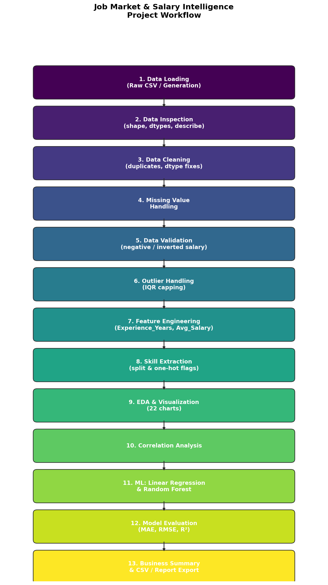

# Job Market & Salary Intelligence

An end-to-end data analysis and machine learning project that cleans raw job-posting
data, explores salary and skill trends, and predicts average salary using Linear
Regression and Random Forest models.



## What this project does

- Cleans messy job-posting data (missing values, duplicates, invalid salary rows)
- Detects and caps salary outliers using the IQR method
- Engineers features (`Experience_Years`, `Avg_Salary`, `Posted_Month`)
- Extracts and analyzes in-demand skills from free-text skill lists
- Produces 22 exploratory charts (demand by role/location, salary distributions,
  correlation heatmaps, skill demand, etc.)
- Trains and compares two salary-prediction models: **Linear Regression** and
  **Random Forest Regression**
- Exports all cleaned data, summaries, and charts automatically

## Results at a glance

| Metric | Value |
|---|---|
| Total Job Postings | 1,000 |
| Average Salary | ₹11,55,227.92 |
| Most Common Job Title | Business Analyst |
| Most Common Location | Pune |
| Most In-Demand Skill | SQL |
| Linear Regression R² | 0.9443 |
| Random Forest R² | 0.9326 |

Sample charts and CSV outputs from an actual run are included in
[`sample_outputs/`](sample_outputs/) so you can browse results without running
anything.

## Project Structure

```
.
├── README.md
├── requirements.txt
├── LICENSE
├── .gitignore
│
├── src/
│   └── job_market_salary_intelligence.py   <- full project code (single file)
│
├── sample_outputs/
│   ├── data/      <- 9 CSVs from an actual run (cleaned data, summaries, model results)
│   └── charts/    <- 22 PNG charts from an actual run
│
└── docs/
    ├── Job_Market_Salary_Intelligence_Report.pdf   <- full project report
    ├── Technologies_and_Libraries.md               <- tech stack details
    └── project_workflow_diagram.png                <- pipeline diagram
```

## How to Run

1. Clone the repo:
   ```bash
   git clone https://github.com/<your-username>/job-market-salary-intelligence.git
   cd job-market-salary-intelligence
   ```
2. Install dependencies:
   ```bash
   pip install -r requirements.txt
   ```
3. Run the script:
   ```bash
   python src/job_market_salary_intelligence.py
   ```
   No dataset needed — it auto-generates a realistic 1,000-row sample dataset on
   first run. Outputs are written to `outputs/data/` and `outputs/charts/`
   (git-ignored so your own runs don't clutter the repo).

   Works the same way pasted into a **Jupyter Notebook** or **Google Colab**
   cell — charts will render inline automatically.

## Machine Learning Approach

- **Target:** `Avg_Salary`
- **Features:** `Experience_Years`, `Job_Title`, `Location`, `Skills`, `Employment_Type`
- **Encoding:** One-Hot Encoding via `ColumnTransformer` + `Pipeline`
- **Split:** 80% train / 20% test
- `Salary_Min` / `Salary_Max` are deliberately excluded from the features since
  `Avg_Salary` is derived directly from them (avoids target leakage).

## Tech Stack

Python · pandas · numpy · matplotlib · seaborn · scikit-learn

See [`docs/Technologies_and_Libraries.md`](docs/Technologies_and_Libraries.md) for
full details on every library and technique used.

## License

This project is licensed under the MIT License — see [LICENSE](LICENSE).
"# job-market-" 
"# job-market-" 
